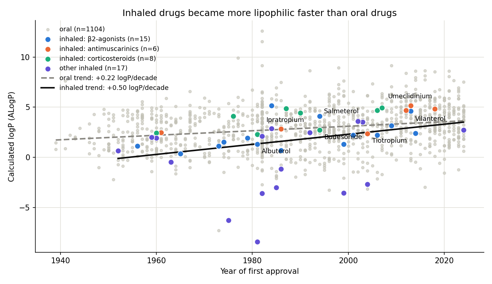
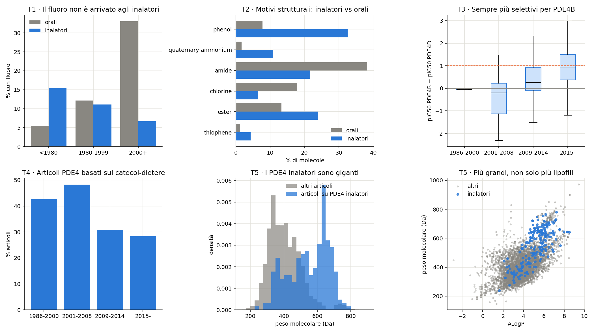

# Is there a "Rule of 5" for inhaled drugs?

[](https://github.com/sMelegar8/inhaled-drug-rule-of-5/actions/workflows/tests.yml)
[](https://smelegar8.github.io/inhaled-drug-rule-of-5/)


Lipinski's Rule of 5 describes oral drugs. Inhaled drugs act in the lung and follow
different constraints, so this project asks whether their physicochemical properties
look different, and how they changed over time. It then applies the same lens to
**PDE4 inhibitors**, a respiratory target with both oral and inhaled programmes.

The project uses only public data (ChEMBL 37 and openFDA) and covers the full path
from download to an interactive SQL app. Every number is reproducible from the scripts.

**[Open the live SQL workbench](https://smelegar8.github.io/inhaled-drug-rule-of-5/)**: query the
database in the browser, with charts and statistics that update with each query.



## Key findings

Analysis set after cleaning: **46 lung-targeted inhaled drugs vs 1,108 oral drugs**
approved by the FDA.

| Finding | Effect | Test |
|---|---|---|
| Inhaled drugs became more lipophilic over time, faster than oral drugs | Spearman ρ(year, ALogP) 0.51 vs 0.25; 95% bootstrap CI of the difference 0.02 to 0.43 | bootstrap, 4,000 resamples |
| The trend holds inside each respiratory class (β2-agonists, antimuscarinics, corticosteroids) | +0.43 logP per decade, class-adjusted | permutation within class, p = 0.002 |
| Same pattern for flexibility | +1.06 rotatable bonds per decade, class-adjusted | permutation, p = 0.002 |
| Fluorination did not reach inhaled drugs | approved from 2000: 1 of 15 inhaled vs 136 of 411 oral are fluorinated | logistic LR test (year × route), p = 0.005 |
| Quaternary ammonium is enriched in inhaled drugs | 10.9% vs 1.7%, odds ratio 7.0 | Fisher exact, Holm over 10 motifs, p = 0.017 |
| Compounds from inhaled PDE4 programmes are much larger | median MW 571 vs 393 Da, rotatable bonds 9 vs 5 | Mann-Whitney at paper level (7 vs 423 papers), p = 0.002 |
| PDE4 papers moved away from the catechol diether scaffold | 48% (2001-08) to 28% (2015+) of papers | Spearman at paper level (n = 430), p = 0.003 |

PDE4B over PDE4D selectivity also rose over time, but at paper level the trend is
borderline (p = 0.051), so I report it as a lead, not a result.



## What this project shows

- **Data acquisition with provenance**: targeted downloads from the ChEMBL API and the
  openFDA bulk export, with record counts, retrieval time and SHA-256 hash for each file
  (`data/raw/manifest.json`, `dataset_info` table).
- **Data modelling in SQL**: a documented SQLite schema (`sql/schema.sql`,
  `sql/clean_schema.sql`) that links molecules, ATC classes, FDA routes and PDE4 activities.
- **Traceable cleaning**: ordered rules with one reason per excluded record. Raw tables
  stay untouched, and the exclusion ledger is saved as a table and as
  [`reports/cleaning_log.csv`](reports/cleaning_log.csv).
  - PDE4 measurements: 11,954 → 8,793 clean (censored values, curator flags and
    non-nM units removed) → 6,887 molecule-target medians.
  - Molecules: 1,305 → 46 inhaled + 1,108 oral (gases, diagnostics, CNS-acting inhaled
    drugs and gut-local oral drugs excluded).
- **Statistics**: bootstrap confidence intervals, permutation tests, Mann-Whitney,
  Kruskal-Wallis, Holm correction, PCA, effect sizes.
- **Cheminformatics**: structural motifs with RDKit SMARTS patterns.
- **A browser app with tested statistics**: the statistics in `app/stats.js` are checked
  against numpy, pandas and scipy on the real dataset in CI.

## Interactive app

`app/index.html` is a static SQL workbench built with [sql.js](https://sql.js.org) and
Plotly. It runs fully in the browser:

- SQL editor with a searchable schema and column comments
- charts that update with the query result; hovering (or tapping) a point of a
  scatter or PCA score plot shows the molecule's 2D structure, drawn from its SMILES
  with [SmilesDrawer](https://github.com/reymond-group/smilesDrawer) (from a SMILES
  column, or looked up through a ChEMBL ID column)
- working cases: SQL, notes and chart/statistics settings are saved automatically
  (in the browser on GitHub Pages, in the viewer's private storage in the claude.ai
  artifact), so leaving the page never loses work; cases can be created, renamed
  and deleted
- descriptive statistics, Pearson and Spearman correlations, PCA (scree plot, biplot,
  loadings, scores), Mann-Whitney and Kruskal-Wallis tests with Holm correction

The [case study](https://smelegar8.github.io/inhaled-drug-rule-of-5/case-study.html) presents
the analysis as a portfolio project: problem, questions, data, methods, key queries,
results, conclusion and limitations.

A second case study, [PDE4 chemical space](https://smelegar8.github.io/inhaled-drug-rule-of-5/case-study-pde4.html),
groups 5,211 PDE4 inhibitors into eight chemical families with Morgan fingerprints, PCA and
k-means, maps them with t-SNE and compares the families' potency, efficiency, selectivity
and history. It doubles as a compendium of the concepts used (fingerprints, Tanimoto, PCA,
k-means, silhouette, stability, t-SNE, ligand efficiency).

The [data dictionary](https://smelegar8.github.io/inhaled-drug-rule-of-5/data-dictionary.html)
explains every table and column (what one row is, keys, joins and their match rate, fill
rates, value ranges) and opens each example query in the workbench. It is generated from
the database by `src/build_data_dictionary.py`, which fails if a column has no explanation.

The site also has a step-by-step explanation of the pipeline
([How it works](https://smelegar8.github.io/inhaled-drug-rule-of-5/how-it-works.html)) and the
[backlog](https://smelegar8.github.io/inhaled-drug-rule-of-5/backlog.html) of planned work.

## How to run

Requires Python 3.13 and, for the statistics test, Node.js.

```bash
pip install -r requirements.txt
python src/01_download_data.py      # raw files -> data/raw/ (about 63 MB)
python src/02_build_database.py     # SQLite -> data/processed/ + app copy
python src/cleaning.py              # cleaned tables + exclusion ledger
python src/pde4_chemical_space.py  # PDE4 families (RDKit, scikit-learn) -> tables, map, figures
python src/build_data_dictionary.py # app/data-dictionary.json from the database
python src/explore_trends.py        # time trends -> reports/
python src/explore_chemistry.py     # structural trends (RDKit) -> reports/
python tests/validate_stats.py      # app statistics vs numpy/pandas/scipy
python -m http.server 8000 -d app   # then open http://localhost:8000
```

The test and the app also work without the download: they use the database shipped in
`app/`.

## Project structure

```text
src/        download, database build, cleaning, exploration scripts
sql/        table definitions with column comments
notebooks/  cleaning notebook (02_data_cleaning.ipynb), executed with outputs
reports/    result tables, cleaning ledger and figures
app/        static SQL workbench (index.html, stats.js) and explanation pages
tests/      validation of the app statistics against scipy
```

## Limitations

- Small inhaled group (46 drugs), so the confidence intervals are wide.
- Properties are calculated descriptors from ChEMBL (for example ALogP), not measured values.
- Only FDA-approved drugs. The route comes from openFDA product records.
- This is an exploratory analysis of public data, not a validated design rule, and the
  trends are associations, not causes.

## Data and licence

- [ChEMBL 37](https://www.ebi.ac.uk/chembl/) (EMBL-EBI, released 2026-05-01), CC BY-SA 3.0.
- [openFDA Drugs@FDA](https://open.fda.gov/apis/drug/drugsfda/) bulk export (2026-10-20).

The full ChEMBL dump (about 25 GB extracted) was not needed, so the scripts download only
the required slices. Code is released under the [MIT licence](LICENSE). The database in
`app/` derives from ChEMBL and is shared under CC BY-SA 3.0 (see [DATA_LICENSE.md](DATA_LICENSE.md)).

## Author

Matteo Melegari, PhD in chemistry, working on R&D data analysis and digitalization.
[ORCID 0000-0002-7252-7587](https://orcid.org/0000-0002-7252-7587)
